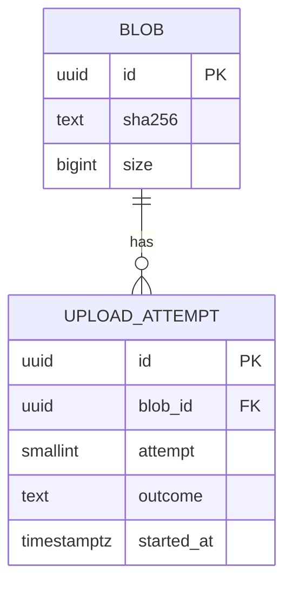

# Retrying blob upload with a circuit breaker

Goal: `PUT /blobs` survives a flaky blob store by retrying up to 3 times behind a circuit breaker, so a store outage returns a fast typed 503 instead of a 30 s hang.

## Scope

Changes:
- retry loop `blob_service::upload::retry::with_retry` around the store call
- circuit breaker `blob_service::upload::breaker::guard` in front of the retry loop
- typed `UploadError` replacing stringly errors on the upload path
- upload header v2: adds `flags` and `attempt`, drops `legacy_ttl`
- TypeScript `upload-client.ts` sends the attempt counter and honours `Retry-After`
- table `upload_attempt` records each attempt
- `config.toml` keys `max_attempts`, `backoff_base_ms`, `breaker_threshold`
- readers of the new keys: `service/src/config.rs` (`RetryConfig::from`), `service/src/upload/mod.rs` (`put`), `service/src/upload/breaker.rs` (`Breaker::new`)

Stays as it is:
- auth, quotas, and the `blobs` table
- checksum algorithm (sha256)
- the `GET /blobs/{id}` path
- the store client library

## Orientation

Placement: `blob-service` accepts browser uploads and writes them to an object store; the web client talks only to the API.
Touched flow: `PUT /blobs`, diagrammed under Behavior.

Glossary:
- attempt: one call to `s3::put_object`
- breaker: per-process counter that rejects calls after consecutive failures
- probe: the single call a half-open breaker lets through
- header: the fixed-size envelope in front of each upload body

```svg-figure Retry and breaker live inside the API process, so the web client never reaches the store directly
<svg viewBox="0 0 600 220" role="img" aria-label="Web client calls the API process, where with_retry and breaker sit in front of the blob store; an open breaker returns BreakerOpen and store timeouts loop back to with_retry">
  <rect class="fig-boundary" x="156" y="28" width="260" height="168" rx="8"/>
  <text class="fig-label is-muted" x="170" y="50">API process</text>

  <rect class="fig-node" x="24" y="84" width="110" height="44" rx="6"/>
  <text class="fig-label" x="79" y="111" text-anchor="middle">web client</text>

  <rect class="fig-node k-new" x="170" y="84" width="112" height="44" rx="6"/>
  <text class="fig-label is-mono" x="226" y="111" text-anchor="middle">with_retry</text>

  <rect class="fig-node k-new" x="300" y="84" width="96" height="44" rx="6"/>
  <text class="fig-label is-mono" x="348" y="111" text-anchor="middle">breaker</text>

  <rect class="fig-node k-context" x="466" y="84" width="110" height="44" rx="6"/>
  <text class="fig-label" x="521" y="111" text-anchor="middle">blob store</text>

  <rect class="fig-node k-failure" x="288" y="150" width="120" height="32" rx="6"/>
  <text class="fig-label is-mono" x="348" y="171" text-anchor="middle">BreakerOpen</text>

  <path class="fig-edge" d="M134 106 H168" marker-end="url(#fig-arrow)"/>
  <text class="fig-label is-mono fig-halo" x="152" y="100" text-anchor="middle">PUT</text>
  <path class="fig-edge" d="M282 106 H298" marker-end="url(#fig-arrow)"/>
  <path class="fig-edge" d="M396 106 H464" marker-end="url(#fig-arrow)"/>
  <text class="fig-label is-mono fig-halo" x="441" y="100" text-anchor="middle">put</text>
  <path class="fig-edge k-failure" d="M348 128 V148" marker-end="url(#fig-arrow)"/>
  <text class="fig-label is-mono" x="358" y="143">open</text>
  <path class="fig-edge is-async k-failure" d="M521 128 V190 H226 V130" marker-end="url(#fig-arrow)"/>
  <text class="fig-label is-mono fig-halo" x="470" y="184" text-anchor="middle">timeout</text>
</svg>
```

## Behavior

Today: one `s3::put_object` call with a 30 s timeout; any store error becomes a 502 string.
Target: up to 3 attempts of 5 s each, 200 ms base backoff doubling, breaker opens after 5 consecutive failures.[^thresholds]

```examples
caption: Each distinct behavior once; cases that behave alike share a row
rows:
  - { given: store healthy, when: "`PUT /blobs` with a 4 MiB body", then: "201 with the etag", kind: wire }
  - { given: store times out twice, when: "`PUT /blobs`", then: "201 after the third attempt, 600 ms later", kind: boundary }
  - { given: breaker open, when: "`PUT /blobs`", then: "503 `BreakerOpen` with `Retry-After: 30`", kind: error }
  - { when: "`PUT /blobs` with a bad checksum", then: "422, no retry", kind: error }
```

```endpoint
caption: PUT /blobs keeps its 201 and gains a typed 503 with Retry-After
method: PUT
path: /blobs/{id}
summary: Store one blob; retried server-side behind the breaker.
auth: { scheme: bearer token }
params:
  - { name: id, in: path, type: uuid, required: true }
  - { name: X-Upload-Attempt, in: header, type: u8, note: "header v2 attempt counter, from 1" }
request: { type: application/octet-stream }
responses:
  - { status: 201, meaning: stored, type: application/json, example: '{ "etag": "9f2c" }' }
  - { status: 422, meaning: checksum mismatch }
  - { status: 502, meaning: attempts exhausted, kind: new, type: application/json, example: '{ "error": "Exhausted", "attempts": 3 }' }
  - { status: 503, meaning: breaker open, kind: new, headers: [Retry-After], type: application/json, example: '{ "error": "BreakerOpen", "retry_after_s": 30, "attempts": 0 }' }
```

```trace
caption: During an outage, each replica's breaker trips on its own after 5 failures
ops:
  - { op: F1, key: replica a }
  - { op: F1, key: replica b }
  - { op: F2, key: replica a }
  - { op: F3, key: replica a }
  - { op: F2, key: replica b }
  - { op: F4, key: replica a }
  - { op: F5, key: replica a, kind: failure }
  - { op: O, key: replica a, kind: risk }
  - { op: F3, key: replica b }
legend:
  - { symbol: F, meaning: "failed store call, numbered per replica" }
  - { symbol: O, meaning: breaker open }
```

```mermaid Every failure path ends in a typed 503 or 502, and the legacy direct path is gone
flowchart TD
  A[PUT /blobs]:::context --> B[breaker::guard]:::new
  W[header v2<br/>attempt counter]:::oneway --> B
  L[legacy::direct_put]:::removed --> C
  B -->|closed| C[s3::put_object]:::changed
  B e1@-->|open| F[503 BreakerOpen]:::failure
  C -->|ok| D[commit row]:::changed
  C e2@-->|timeout| R[backoff and retry]:::risk
  R -->|attempts left| C
  R e3@-->|exhausted| G[502 Exhausted]:::failure
  class e1,e2,e3 failure
```

```mermaid A timed-out attempt is retried once after backoff, and a second failure reaches the client as 503 with Retry-After
sequenceDiagram
  participant W as Web client
  participant A as API
  participant S as Blob store
  W->>A: PUT blob
  A->>S: put_object
  alt store healthy
    S-->>A: 200 etag
    A-->>W: 201 Created
  else store times out
    S--x A: timeout
    A->>S: retry after 200 ms
    S--x A: timeout
    A--x W: 503 Retry-After
  end
  Note over A,S: max_attempts is 3
```

```mermaid An attempt ends in Done or Failed, and only a timeout enters Backoff
stateDiagram-v2
  [*] --> Pending
  Pending --> Sending: guard admits
  Sending --> Done: 200
  Sending --> Backoff: timeout
  Sending --> Failed: 4xx
  Backoff --> Sending: attempts left
  Backoff --> Failed: 3 attempts
  Done --> [*]
  Failed --> [*]
  class Failed failure
```



```steps
caption: A request crosses the breaker, then the retry loop, then the store
steps:
  - { node: web client, verb: PUTs }
  - { node: breaker, verb: admits }
  - { node: with_retry, verb: calls }
  - { node: blob store, verb: returns }
  - { node: 201 with etag, kind: new }
```

```compare
caption: "Four rows change or move: attempts and timeout change, backoff arrives, legacy_ttl leaves, checksum stays"
before: Today
after: With retry
rows:
  - label: attempts
    before: 1
    after: up to 3
  - label: per-attempt timeout
    before: 30 s
    after: 5 s
  - label: backoff
    after: 200 ms doubling
  - label: header field `legacy_ttl`
    before: 4 bytes
  - label: checksum
    before: sha256
    after: sha256
```

Client deadline stays 20 s; worst case is 3 x 5 s plus 200 ms plus 400 ms = 15.6 s.

```matrix
caption: Only the breaker-open column is new behavior; the success column is unchanged
corner: Layer
columns: [success, timeout, 5xx, breaker open]
rows:
  - label: web client
    cells:
      - { text: "`201`", kind: same }
      - { text: "waits for API", kind: same }
      - { text: "shows error", kind: differs }
      - { text: "honours `Retry-After`", kind: new }
  - label: API
    cells:
      - { text: "commit row", kind: same }
      - { text: "retry with backoff", kind: new }
      - { text: "retry, then 502", kind: differs }
      - { text: "`503` immediately", kind: new }
  - label: store
    cells:
      - { text: "`200` etag", kind: same }
      - { text: "attempt abandoned", kind: risk }
      - { text: "error body dropped", kind: failure }
      - { text: "not called", kind: context }
```

```budget
caption: One retry puts p99 at 2200 ms, 200 ms over the 2000 ms limit
unit: ms
limit: 2000
parts:
  - { label: sign, value: 20, kind: plain }
  - { label: connect, value: 80, kind: plain }
  - { label: failed attempt, value: 400, kind: new, note: one fast 5xx }
  - { label: backoff, value: 200, kind: new, note: first retry }
  - { label: transfer, value: 900, kind: plain }
  - { label: checksum, value: 200, kind: plain }
  - { label: commit, value: 150, kind: plain }
  - { label: audit write, value: 250, kind: risk, note: new `upload_attempt` insert }
```

Mitigation: audit write moves off the request path in slice `enable` if the p99 gate fails.

```layout
caption: Header v2 is 65 bytes; the 4-byte legacy_ttl leaves and two new 1-byte fields arrive
unit: bytes
fields:
  - { name: magic, size: 4, kind: plain }
  - { name: version, size: 1, kind: changed, note: 1 becomes 2 }
  - { name: flags, size: 1, kind: new }
  - { name: attempt, size: 1, kind: new }
  - { name: reserved, size: 2, kind: reserved }
  - { name: legacy_ttl, size: 4, kind: removed }
  - { name: blob_id, size: 16, kind: plain }
  - { name: length, size: 8, kind: plain }
  - { name: checksum, size: 32, kind: plain }
```

Fields sum to 69 bytes with `legacy_ttl`; 65 on the wire after it is removed.

```rust
pub async fn with_retry<F, Fut>(cfg: &RetryConfig, mut call: F) -> Result<PutOutcome, UploadError>
where
    F: FnMut(u8) -> Fut,
    Fut: Future<Output = Result<PutOutcome, StoreError>>,
{
    let mut delay = cfg.backoff_base;
    for attempt in 1..=cfg.max_attempts {
        match call(attempt).await {
            Ok(out) => return Ok(out),
            Err(e) if !e.is_retryable() => return Err(UploadError::Rejected(e)),
            Err(_) if attempt == cfg.max_attempts => return Err(UploadError::Exhausted),
            Err(_) => {
                tokio::time::sleep(delay).await;
                delay *= 2;
            }
        }
    }
    Err(UploadError::Exhausted)
}
```

Walkthrough of the same loop, read where it is subtle:

```rust service/src/upload/retry.rs:41-59 E5 the retry loop, chunk by chunk
pub async fn with_retry<F, Fut>(cfg: &RetryConfig, mut call: F) -> Result<PutOutcome, UploadError>
where
    F: FnMut(u8) -> Fut,
    Fut: Future<Output = Result<PutOutcome, StoreError>>,
{
    let mut delay = cfg.backoff_base;
    for attempt in 1..=cfg.max_attempts {
        match call(attempt).await {
            Ok(out) => return Ok(out),
            Err(e) if !e.is_retryable() => return Err(UploadError::Rejected(e)),
            Err(_) if attempt == cfg.max_attempts => return Err(UploadError::Exhausted),
            Err(_) => {
                tokio::time::sleep(delay).await;
                delay *= 2;
            }
        }
    }
    Err(UploadError::Exhausted)
}
```

- L43-L44 — contract: `call` receives the attempt number, so each attempt can tag its request; `FnMut` lets it count.
- L50-L51 — trap: the guards are ordered, so a non-retryable error on the last attempt is a rejection, never reported as exhaustion.
- L52-L55 — decision: doubling backoff without jitter; one process holds one breaker, so retries do not stampede.
- L58 — only reached when `max_attempts` is 0.

The same change as a reviewer reads it, one hunk with its notes:

```diff service/src/upload/mod.rs PR #57 the upload entry point, before and after
@@ -12,7 +12,9 @@ pub async fn put(req: PutRequest) -> Result<PutOutcome, UploadError> {
     let header = parse_header(&req.body)?;
-    if header.version != 1 {
-        return Err("unsupported header".into());
+    if !matches!(header.version, 1 | 2) {
+        return Err(UploadError::BadHeader(header.version));
     }
-    store.put_object(&header.blob_id, &req.body).await
-        .map_err(|e| e.to_string())
+    guard(&BREAKER)?;
+    let cfg = RetryConfig::from(&CONFIG);
+    with_retry(&cfg, |attempt| store.put_object(&header.blob_id, &req.body, attempt)).await
+        .inspect_err(|e| BREAKER.record(e))
 }
```

- L13-L14 — contract: a v1 client still parses; v2 adds the `attempt` byte, so both versions are accepted.
- -L16-L17 — trap: the old path flattened store errors to strings, so callers could not tell a timeout from a rejection.
- L16-L19 — decision: the breaker is checked before any attempt and records each failure; retries run inside it.

```typescript
export async function putBlob(blob: Blob, id: string): Promise<string> {
  const res = await fetch(`/blobs/${id}`, {
    method: "PUT",
    headers: { "x-upload-version": "2" },
    body: blob,
    signal: AbortSignal.timeout(20_000),
  });
  if (res.status === 503) {
    throw new BreakerOpen(Number(res.headers.get("retry-after") ?? 30));
  }
  if (!res.ok) throw new UploadFailed(res.status);
  return (await res.json()).etag;
}
```

```sql
CREATE TABLE upload_attempt (
  id          uuid PRIMARY KEY,
  blob_id     uuid NOT NULL REFERENCES blobs (id),
  attempt     smallint NOT NULL CHECK (attempt BETWEEN 1 AND 3),
  outcome     text NOT NULL,
  started_at  timestamptz NOT NULL DEFAULT now()
);
CREATE INDEX upload_attempt_blob_idx ON upload_attempt (blob_id);
```

```toml
[upload]
max_attempts      = 3
backoff_base_ms   = 200
breaker_threshold = 5
breaker_open_s    = 30
```

Signatures, before and after:

```rust upload/mod.rs — the signature before and after
pub async fn put(blob: Blob) -> Result<Etag, String>
pub async fn put(blob: Blob, cfg: &UploadConfig) -> Result<Etag, UploadError>
```

```json
{ "error": "BreakerOpen", "retry_after_s": 30, "attempts": 0 }
```

```bash
cargo test -p blob-service --no-fail-fast && cargo clippy --all-targets -- -D warnings
npm --prefix web test -- upload-client
```

```yaml
# .github/workflows/ci.yml (excerpt)
jobs:
  upload:
    steps:
      - run: cargo test -p blob-service
      - run: npm --prefix web test
```

## Owner's view

| Invariant or limit | What enforces it | How this change keeps it |
|---|---|---|
| An upload is written at most once per `blob_id` | the store's conditional `PUT` on `blob_id` E1 | every retry reuses the same `blob_id`, so a replay overwrites |
| A client never waits past 20 s | `AbortSignal.timeout(20_000)` in `upload-client.ts` E2 | the server budget stays under 2 s per attempt, 3 attempts at most |
| Breaker state never crosses processes | one `Breaker` per process in `service/src/upload/breaker.rs` E4 | no shared store is added; each replica trips alone |
| Header v1 parses until the switch | `parse_header` at `service/src/upload/mod.rs:L13` accepts version 1 E3 | v2 only adds fields at the end; v1 stays accepted until "Switch to header v2" |

## Decisions

One-way first.

| Decision | Reversibility | Chosen | Cost paid — by whom | Rejected — and why it loses |
|---|---|---|---|---|
| How does the server learn the attempt number? | one-way | header v2 `attempt` byte | clients in the field cannot be recalled; paid by old browsers | query string: proxies strip it |
| What identifies a retried upload? | reversible | same `blob_id` on every attempt | store sees overwrites | a fresh id per attempt: duplicates blobs |
| Where does breaker state live? | internal | in-memory per process | each replica trips alone | shared Redis: new dependency |

```cards
caption: One decision is one-way; the breaker's storage and thresholds can change later
decisions:
  - question: How does the server learn the attempt number?
    chosen: "header v2 with a 1-byte `attempt`"
    reversibility: one-way
    why: the server logs and caps attempts without parsing URLs
    cost: old browsers keep sending v1 until the web bundle is replaced
    owner: user
    rejected:
      - option: query string `?attempt=2`
        reason: proxies strip or cache it
      - option: separate handshake request
        reason: adds one round trip to every upload
  - question: What identifies a retried upload?
    chosen: "the same `blob_id` on every attempt"
    reversibility: reversible
    why: a replayed `PUT` overwrites instead of duplicating
    cost: the store may see two writes of one blob
    rejected:
      - option: a fresh id per attempt
        reason: a timed-out success leaves a duplicate blob
  - question: Where does breaker state live?
    chosen: "in memory, per process"
    reversibility: internal
    why: no extra dependency or round trip
    cost: each replica trips on its own
    rejected:
      - option: shared Redis counter
        reason: new dependency on the failure path
      - option: no breaker, retries only
        reason: every request waits through 3 attempts during an outage
```

## Risks and accepted unknowns

```riskmap
caption: Retry storms after an outage are the only high-likelihood, high-impact risk
risks:
  - { title: retry storm when the store recovers, likelihood: high, impact: high, note: all replicas probe at once }
  - { title: duplicate blob after a timed-out success, likelihood: medium, impact: high }
  - { title: old clients still send header v1, likelihood: high, impact: medium }
  - { title: breaker trips on 4xx, likelihood: low, impact: medium }
  - { title: web bundle grows by the client code, likelihood: medium, impact: low }
  - { title: jitter skew across replicas, likelihood: low, impact: low }
```

- Risk: all replicas leave Open at the same 30 s mark and probe together. Mitigation: open time gets 0-5 s of jitter per replica.
- Risk: a success that times out client-side is retried and written twice. Mitigation: same `blob_id` makes the second write an overwrite.
- Risk: a 4xx counted as a failure opens the breaker for every user. Mitigation: only timeouts and 5xx count; `breaker_ignores_4xx` guards it.
- Accepted: the web bundle grows; the size is not measured here.
- Accepted: per-process breakers mean a 3-replica service trips after up to 15 failures in total.
- Accepted: the store's real recovery behavior after a long outage is unknown.
- Blind spot: no test runs against a real store outage; the breaker is exercised with a fake store only.

Open questions, settled before the flag is on:

- **Q1** — does the store send `Retry-After` with a 503, or does the breaker pick its own open time?
- **Q2** — does the half-open probe count as an attempt?

Q1 is tracked as issue #41 and settles the breaker's open time; Q2 waits on PR #57, which reverts commit 9f3c2ab.

## Changes

| Path | Status | What it holds | What changes |
|---|---|---|---|
| `service/src/upload/retry.rs` | added | the retry loop `with_retry` | retries a store call 3 times with doubling backoff |
| `service/src/upload/breaker.rs` | added | the breaker state machine | opens after 5 consecutive failures |
| `service/src/upload/error.rs` | added | the typed `UploadError` | replaces string errors on the upload path |
| `web/src/upload-client.ts` | added | the browser upload client | sends header v2 and honours `Retry-After` |
| `migrations/0007_upload_attempt.sql` | added | the `upload_attempt` table | records one row per attempt |
| `service/src/upload/mod.rs` | modified | the upload entry point `put` | wires `guard` and `with_retry` in front of the store |
| `service/src/routes.rs` | modified | the HTTP routes | maps `UploadError` to 503 and 502 |
| `service/src/s3.rs` | modified | the store client wrapper | marks which errors are retryable |
| `web/src/UploadForm.tsx` | modified | the upload form | shows the `Retry-After` wait |
| `config.toml` | modified | service configuration | adds the `[upload]` keys |
| `service/src/upload/legacy.rs` | removed | the direct store put | goes away: it bypassed the guard |

Runtime data: `state.json` in each replica's data dir keeps the breaker's last state across a restart; `config.toml` supplies the thresholds.
`UploadError` implements `std::error::Error`, and the route maps it with `crate::upload::error::to_response`.

```tree
caption: The change adds 5 files, modifies 5, and removes 1; the legacy path is the only deletion
root: blob-service
files:
  - { path: service/src/upload/retry.rs, status: added, note: retry loop }
  - { path: service/src/upload/breaker.rs, status: added, note: breaker state machine }
  - { path: service/src/upload/error.rs, status: added, note: typed `UploadError` }
  - { path: service/src/upload/mod.rs, status: modified, note: wires guard and retry }
  - { path: service/src/upload/legacy.rs, status: removed, note: direct put }
  - { path: service/src/routes.rs, status: modified, note: maps errors to 503 and 502 }
  - { path: service/src/s3.rs, status: modified, note: reports retryable errors }
  - { path: service/src/auth.rs, status: context, note: read only }
  - { path: web/src/upload-client.ts, status: added, note: sends header v2 }
  - { path: web/src/UploadForm.tsx, status: modified, note: shows Retry-After }
  - { path: migrations/0007_upload_attempt.sql, status: added, note: new table }
  - { path: config.toml, status: modified, note: "new `[upload]` keys" }
```

```stack
caption: put_blob now reaches the store only through guard and with_retry; the legacy call is removed
frames:
  - call: routes::put_blob
    mark: changed
    note: maps the typed error
    calls:
      - call: auth::authorize
        mark: context
      - call: breaker::guard
        mark: added
        calls:
          - call: retry::with_retry
            mark: added
            calls:
              - call: s3::put_object
                mark: called
              - call: audit::record_attempt
                mark: added
      - call: legacy::direct_put
        mark: removed
```

```layers
caption: The web client reaches the store only through the API's retry and breaker; a direct route must not exist
tiers:
  - name: Web
    nodes: [UploadForm.tsx, { name: upload-client.ts, kind: new }]
  - name: API
    note: one process per replica
    nodes: [routes.rs, { name: retry.rs, kind: new }, { name: breaker.rs, kind: new }]
  - name: Store
    nodes: [s3.rs, { name: blob store, kind: context }]
crossings:
  - { from: UploadForm.tsx, to: upload-client.ts, label: calls }
  - { from: upload-client.ts, to: routes.rs, label: PUT }
  - { from: routes.rs, to: breaker.rs, label: guards }
  - { from: breaker.rs, to: retry.rs, label: admits }
  - { from: retry.rs, to: s3.rs, label: calls }
  - { from: s3.rs, to: blob store, label: put_object }
  - { from: upload-client.ts, to: blob store, label: direct upload, absent: true, note: browsers hold no store credentials }
```

## Delivery

```timeline
caption: Retries go live behind a flag first; the header v2 switch in wave 4 is the point of no return
steps:
  - { title: Merge scaffolding, when: wave 1, kind: step, detail: types and config keys only, rollback: revert the merge }
  - { title: Shadow breaker, when: wave 2, kind: gate, detail: "zero false trips in 48 h" }
  - { title: Retries for 10% of uploads, when: wave 3, kind: step, detail: flag `upload_retry` at 10%, rollback: flag off, current: true }
  - { title: Switch to header v2, when: wave 4, kind: oneway, detail: clients now send the attempt byte }
  - { title: Remove the legacy path, when: wave 5, kind: step, rollback: revert the removal }
```

```waves
caption: Types and the breaker start in parallel; the header switch and the legacy removal come last
items:
  - { title: Add `UploadError` and config keys, needs: [], status: scaffolding }
  - { title: Add the breaker behind a flag, needs: [], status: feature-flag }
  - { title: Add with_retry behind a flag, needs: ["Add `UploadError` and config keys", "Add the breaker behind a flag"], status: feature-flag }
  - { title: Ship upload-client.ts, needs: ["Add `UploadError` and config keys"], status: backward-compatible }
  - { title: Switch to header v2, needs: ["Add with_retry behind a flag", "Ship upload-client.ts"], status: breaking }
  - { title: Remove legacy direct put, needs: ["Switch to header v2"], status: breaking }
```

| Slice | Needs | Mergeability | Verify |
|---|---|---|---|
| Add `UploadError` and config keys | none | scaffolding | `cargo test -p blob-service types` |
| Add the breaker behind a flag | none | feature-flag | `cargo test -p blob-service breaker` |
| Add with_retry behind a flag | Add `UploadError` and config keys; Add the breaker behind a flag | feature-flag | `cargo test -p blob-service retry` |
| Ship upload-client.ts | Add `UploadError` and config keys | backward-compatible | `npm --prefix web test` |
| Switch to header v2 | Add with_retry behind a flag; Ship upload-client.ts | breaking | `cargo test -p blob-service --no-fail-fast` |
| Remove legacy direct put | Switch to header v2 | breaking | `cargo clippy --all-targets` |

### Add `UploadError` and config keys
- files: `service/src/upload/error.rs`, `config.toml`
- needs: none
- verify: `cargo test -p blob-service types`
- mergeability: `scaffolding`
- constraints: no behavior change; the keys have defaults

### Add the breaker behind a flag
- files: `service/src/upload/breaker.rs`
- needs: none
- verify: `cargo test -p blob-service breaker`
- mergeability: `feature-flag`
- constraints: flag off means the call path is untouched

## Acceptance and tests

Breaker and retry are tested as pure state machines with a fake clock; the route is tested with a fake store.
Each test below runs as `cargo test <name>` and must report 1 passed.

| Criterion | Test (status, name) | Protects |
|---|---|---|
| a timeout is retried after 200 ms, then 400 ms | new `service/tests/retry.rs::timeout_is_retried_with_doubling_backoff` | backoff not doubling |
| the 3rd failure returns `Exhausted` | new `service/tests/retry.rs::third_failure_is_exhausted` | an extra or missing attempt |
| 5 consecutive failures open the breaker | new `service/tests/breaker.rs::five_failures_open_the_breaker` | threshold off by one |
| a 4xx never counts as a failure | new `service/tests/breaker.rs::breaker_ignores_4xx` | R4 |
| an open breaker answers 503 with `Retry-After` | new `service/tests/routes.rs::open_breaker_answers_503_with_retry_after` | R1 contract |
| a half-open breaker admits one probe | new `service/tests/breaker.rs::half_open_admits_a_single_probe` | R1 |
| the success path still returns 201 | changed `service/tests/routes.rs::put_blob_returns_201` | regression on commit |
| a bad checksum still returns 422 | existing `service/tests/routes.rs::bad_checksum_is_422` | untouched path |
| auth failures still return 401 | existing `service/tests/auth.rs::missing_token_is_401` | untouched path |

Total: 6 new, 1 changed, 2 existing.

| Gate | Result |
|---|---|
| `cargo test -p blob-service` | pass |
| `npm --prefix web test` | pass |
| p99 within 2000 ms with one retry | fails by 200 ms; see the budget |

## Impact

| Lane | State | Why |
|---|---|---|
| API | affected | 503 with `Retry-After` is new; header v2 |
| Data at rest | affected | table `upload_attempt` is new |
| Concurrency | unaffected | breaker state sits behind one mutex per process |
| Resource bounds | affected | 3 attempts triple store calls in the worst case |
| Observability | affected | each attempt is logged and stored |
| Compatibility | affected | v1 clients keep working until the header switch |
| Configuration | affected | 4 keys in `config.toml` |
| Tests | affected | 6 new, 1 changed test |
| Security | n/a | no new credentials leave the API |

## Start here

Open `service/src/upload/error.rs` and add the `UploadError` enum with `Rejected`, `Exhausted` and `BadHeader`; `cargo test -p blob-service types` is the first check.

[^thresholds]: The thresholds come from the store's own retry guidance.
