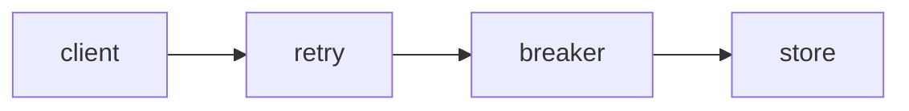

# Reference links

Every kind of reference the renderer makes clickable and hoverable, in one page. The gallery cannot hold these: its
contract forbids network links and link destinations that are not page text.

## Flows

Uploads retry three times with doubling backoff, then fail with a typed error.

## Questions

- **Q1** — does the store send `Retry-After` with a 503?
- **Q2** — does the half-open probe count as an attempt?

### F3 — the store stalls instead of failing

A stalled store holds every attempt for the full timeout.

## Cross-references

- Section: the retry rule is in [Flows](#flows); the stall is [F3](#def-F3).
- Figure: [the breaker figure](#fig-retry-and-breaker) shows where the breaker sits.
- Defined ids: Q1 decides the open time; F3 is why the timeout is short; Q2 waits on the probe.
- History: tracked as issue #41, landed in PR #57, which reverts commit 9f3c2ab.
- Outside: the store's errors are in [the S3 error reference](https://docs.aws.amazon.com/AmazonS3/latest/API/ErrorResponses.html).
- A footnote previews too.[^store]

[^store]: The store is S3-compatible, but its 503 has no body.
